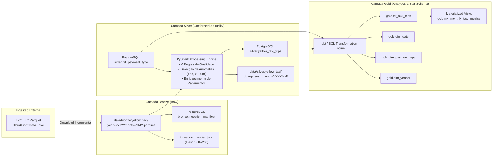
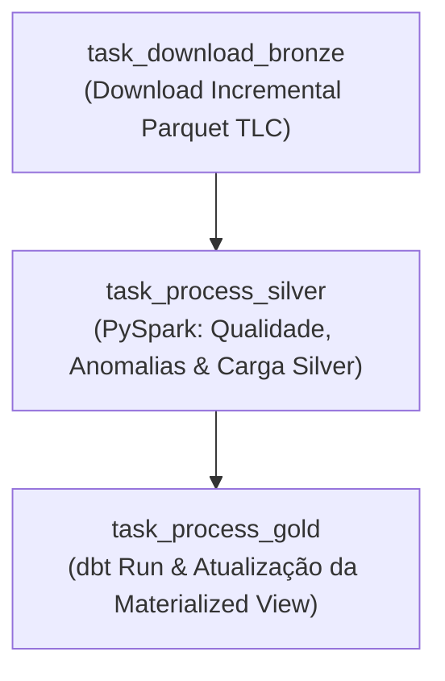

# Urban Mobility Analytics — NYC TLC Yellow Taxi Data Pipeline

Pipeline de dados analítico end-to-end para análise de corridas de táxi da base pública do **NYC Taxi and Limousine Commission (TLC)**, implementado na **Arquitetura Medalhão (Bronze, Silver e Gold)** com **Python**, **PySpark**, **PostgreSQL**, **dbt** e **Apache Airflow**.

---

## 1. Visão Geral da Arquitetura Medalhão

O pipeline estrutura os dados em três camadas com responsabilidades bem definidas:



- **Bronze (Bruta)**: Armazenamento fiel dos arquivos Parquet originais da NYC TLC, organizados em diretórios particionados por ano e mês (`year=YYYY/month=MM/`). O download é incremental, com controle de idempotência e integridade garantido por hash SHA-256 e manifesto de auditoria (`data/metadata/ingestion_manifest.json` e tabela `bronze.ingestion_manifest`).
- **Silver (Tratada e Padronizada)**: Leitura dos arquivos da Bronze via **PySpark**, conversão explícita de tipos, aplicação de 6 regras de qualidade estruturais, sinalização de anomalias (viagens com mais de 6 horas ou mais de 100 milhas), enriquecimento com a tabela de referência de pagamentos (`ref_payment_type`), cálculo de receita válida (`valid_revenue_amount`), gravação em Parquet particionado por competência (`pickup_year_month=YYYYMM`) e carga atômica com troca de partição no PostgreSQL (`silver.yellow_taxi_trips`).
- **Gold (Analítica & Dimensional)**: Modelagem dimensional em Star Schema construída via **dbt** (com fallback SQL nativo), contendo dimensões conformadas (`dim_vendor`, `dim_payment_type`, `dim_date`), tabela fato (`fct_taxi_trips`) e uma **Materialized View** (`gold.mv_monthly_taxi_metrics`) com os indicadores de frotistas e competências solicitados pelo desafio.

---

## 2. Justificativa Técnica das Ferramentas Utilizadas

| Ferramenta | Fase / Camada | Justificativa Técnica |
| :--- | :--- | :--- |
| **Python** | Ingestão (Bronze) & Scripts | Linguagem padrão na Engenharia de Dados. Permite downloads de streaming via HTTP em chunks de memória controlados (1 MB), cálculo de checksum SHA-256 para idempotência, manipulação leve de metadados e flexibilidade para construção da CLI e testes unitários. |
| **PySpark** | Processamento (Silver) | O volume mensal de corridas de Yellow Taxi em NYC alcança **milhões de registros por mês** (~3 a 4 milhões/mês). O PySpark distribui a computação em memória com o otimizador Catalyst, permitindo processar múltiplos meses sem risco de *Out-Of-Memory* (OOM), aplicando filtros vetorizados e gravando partições colunares Snappy Parquet com alta taxa de compressão. |
| **PostgreSQL** | Armazenamento & Serving Layer | Banco de dados relacional confiável, robusto e compatível com ACID. Atua como o Data Warehouse analítico do projeto, suportando índices em colunas estratégicas (`pickup_year_month`, `VendorID`), integridade referencial entre fatos e dimensões, e suporte nativo a **Materialized Views** com atualização concorrente (`REFRESH MATERIALIZED VIEW CONCURRENTLY`). |
| **dbt (data build tool)** | Modelagem Analítica (Gold) | Permite aplicar as melhores práticas de Engenharia de Software no SQL analítico (ELT): modularização de código, linhagem automática (DAG de modelos), controle de versão, documentação de colunas e testes automatizados de qualidade de dados (`unique`, `not_null`, `relationships`). |
| **Apache Airflow** | Orquestração & Agendamento | Permite agendamento semanal programático (`@weekly`), gerenciamento de dependências entre tarefas heterogêneas (Download -> PySpark -> dbt), políticas automáticas de retentativa (`retries`), controle de concorrência, observabilidade e rastreabilidade total de execuções históricas. |

---

## 3. Tabela de Referência de Pagamentos (Requisito 4)

Criada no schema `silver.ref_payment_type` e espelhada em `gold.dim_payment_type`:

| payment_type | payment_description | is_valid_payment |
| :---: | :--- | :---: |
| **1** | Credit card | `true` |
| **2** | Cash | `true` |
| **3** | No charge | `false` |
| **4** | Dispute | `false` |
| **5** | Unknown | `false` |
| **6** | Voided trip | `false` |

---

## 4. Regras de Qualidade e Anomalias (Requisito 5)

No processamento da camada Silver, o PySpark avalia:

### Regras de Qualidade Estruturais (`is_valid_trip` e `invalid_reason`):
1. **`pickup_datetime_nula`**: Data e hora de embarque ausente.
2. **`dropoff_datetime_nula`**: Data e hora de desembarque ausente.
3. **`desembarque_antes_ou_igual_embarque`**: Timestamp de desembarque menor ou igual ao embarque.
4. **`duracao_nao_positiva`**: Duração da viagem menor ou igual a 0 minutos.
5. **`distancia_nula_ou_negativa`**: Distância percorrida nula ou menor que 0 milhas.
6. **`valor_total_nulo_ou_negativo`**: Valor total cobrado nulo ou menor que 0.

> A coluna `is_valid_trip` será `true` apenas se nenhuma das regras acima for violada. Caso contrário, `invalid_reason` armazena as violações separadas por ponto e vírgula.

### Detecção de Anomalias (`is_anomaly` e `anomaly_reason`):
- **Duração excessiva**: `trip_duration_minutes > 360` (mais de 6 horas) -> sinalizado com `duracao_acima_6_horas`.
- **Distância excessiva**: `trip_distance > 100` (mais de 100 milhas) -> sinalizado com `distancia_acima_100_milhas`.
- **Impacto**: Anomalias **não invalidam** estruturalmente a corrida por si sós, permitindo auditorias operacionais e investigações de fraude.

### Validação de Receita (`valid_revenue_amount`):
- A receita só é computada como válida quando a corrida for válida (`is_valid_trip = true`) **E** o pagamento for considerado válido (`is_valid_payment = true` — Credit card ou Cash). Nos demais casos, o valor é zerado (`0.0`).

---

## 5. Modelagem Analítica Gold & Materialized View (Requisitos 6 e 7)

### Modelo Dimensional Star Schema
- **`gold.dim_vendor`**: Frotistas oficiais do NYC TLC (1: Creative Mobile Technologies, 2: VeriFone, 0: Unknown).
- **`gold.dim_payment_type`**: Formas de pagamento homologadas e flag de receita válida.
- **`gold.dim_date`**: Dimensão de calendário enriquecida com dia da semana, mês, trimestre e flag de final de semana.
- **`gold.fct_taxi_trips`**: Tabela fato com métricas financeiras, operacionais, flags de qualidade e chaves estrangeiras.

### Materialized View: `gold.mv_monthly_taxi_metrics`
Exibe os indicadores analíticos exigidos no desafio, agrupados por competência (`pickup_year_month`) e frotista (`vendor_id`):

- **Total de corridas por mês** (`total_trips`)
- **Valor total das corridas válidas** (`total_valid_revenue`)
- **Ticket médio por corrida** (`avg_ticket_per_trip`)
- **Distância média** (`avg_trip_distance`)

```sql
SELECT
    f.pickup_year_month,
    f.vendor_id,
    v.vendor_name,
    COUNT(*) AS total_trips,
    ROUND(SUM(CASE WHEN f.is_valid_trip AND f.is_valid_payment THEN f.total_amount ELSE 0 END)::numeric, 2) AS total_valid_revenue,
    ROUND(AVG(CASE WHEN f.is_valid_trip AND f.is_valid_payment THEN f.total_amount ELSE NULL END)::numeric, 2) AS avg_ticket_per_trip,
    ROUND(AVG(CASE WHEN f.is_valid_trip THEN f.trip_distance ELSE NULL END)::numeric, 2) AS avg_trip_distance,
    CURRENT_TIMESTAMP AS last_refreshed_at
FROM gold.fct_taxi_trips f
LEFT JOIN gold.dim_vendor v ON f.vendor_id = v.vendor_id
GROUP BY f.pickup_year_month, f.vendor_id, v.vendor_name
ORDER BY f.pickup_year_month, f.vendor_id;
```

---

## 6. Orquestração com Apache Airflow (Requisito 8)

A DAG `urban_mobility_nyc_taxi_pipeline` está configurada em `dags/nyc_taxi_medallion_dag.py` com agendamento semanal (`@weekly`):



- **`task_download_bronze`**: Realiza o download dos arquivos mensais TLC para o período selecionado de forma incremental.
- **`task_process_silver`**: Executa o processador PySpark, grava a camada Silver em Parquet e realiza a carga particionada no PostgreSQL.
- **`task_process_gold`**: Executa as transformações dbt (ou SQL nativo) para gerar o Star Schema e atualiza a Materialized View `gold.mv_monthly_taxi_metrics`.

---

## 7. Estrutura do Projeto

```
urban_mobility_pipeline1/
├── dags/
│   └── nyc_taxi_medallion_dag.py     # DAG semanal do Apache Airflow
├── dbt/                              # Projeto dbt para camada Gold
│   ├── dbt_project.yml
│   ├── profiles.yml
│   └── models/
│       ├── staging/                  # Staging Silver (stg_yellow_taxi_trips, stg_payment_types)
│       └── gold/                     # Star Schema (dim_vendor, dim_date, dim_payment_type, fct_taxi_trips, mv_monthly_taxi_metrics)
├── sql/                              # Scripts DDL para PostgreSQL
│   ├── 01_create_schemas.sql         # Cria schemas bronze, silver, gold e tabela de manifesto
│   ├── 02_reference_payment_types.sql# Cria e popula silver.ref_payment_type
│   ├── 03_create_silver_tables.sql   # DDL das tabelas silver e staging
│   ├── 04_create_gold_models.sql     # DDL de dimensões, fato e Materialized View
│   └── 05_refresh_materialized_view.sql # Comando de atualização da MV
├── src/
│   ├── ingestion/
│   │   └── downloader.py             # Módulo de download incremental TLC
│   ├── processing/
│   │   ├── spark_session.py          # Configuração do Spark e driver JDBC
│   │   └── silver_processor.py       # Engine PySpark de limpeza, regras e anomalias
│   ├── database/
│   │   └── postgres_loader.py        # Carga atômica JDBC e transações PostgreSQL
│   ├── transform/
│   │   └── dbt_runner.py             # Runner do dbt com fallback SQL
│   └── main.py                       # CLI principal para execução local
├── tests/                            # Testes automatizados com Pytest
│   ├── test_downloader.py            # Testes de download, integridade e manifesto
│   ├── test_silver_rules.py          # Testes de regras de negócio, anomalias e receita
│   ├── test_sql_scripts.py           # Testes de consistência dos scripts SQL
│   └── test_dbt_project.py           # Testes de conformidade do projeto dbt
├── data/                             # Data lake local (Bronze, Silver, Metadata)
├── docker-compose.yml                # Ambiente completo Docker (Airflow + PostgreSQL)
├── requirements.txt                  # Dependências Python
└── README.md                         # Documentação completa do projeto
```

---

## 8. Como Executar o Projeto

### Pré-requisitos
- Python 3.10, 3.11 ou 3.12
- Java 17 ou 21 (necessário para o PySpark)
- PostgreSQL ativo (porta padrão configurável no `.env`)

### Configuração do Ambiente
1. Clone o repositório e acerte as variáveis de ambiente:
```bash
cp .env.example .env
```
2. Crie e ative o ambiente virtual:
```bash
python -m venv .venv
# No Windows (PowerShell):
.\.venv\Scripts\Activate.ps1
# No Linux/macOS:
source .venv/bin/activate
```
3. Instale as dependências:
```bash
pip install -r requirements.txt
```

### Inicialização do Banco de Dados PostgreSQL
Execute o passo de criação dos schemas e tabelas de referência:
```bash
python src/main.py --step init-db
```

### Execução Completa do Pipeline (Bronze -> Silver -> Gold)
Para baixar e processar os **6 meses de dados de 2025** (Janeiro a Junho):
```bash
python src/main.py --year 2025 --start-month 1 --end-month 6 --step all
```

Você também pode executar etapas individuais:
- Apenas Ingestão Bronze:
  ```bash
  python src/main.py --year 2025 --start-month 1 --end-month 6 --step bronze
  ```
- Apenas Processamento Silver (PySpark):
  ```bash
  python src/main.py --year 2025 --start-month 1 --end-month 6 --step silver
  ```
- Apenas Modelagem Gold & Materialized View (dbt / SQL):
  ```bash
  python src/main.py --step gold
  ```

---

## 9. Execução dos Testes de Qualidade

Para executar a suíte completa de testes automatizados com Pytest:
```bash
pytest tests/ -v
```

Caso queira executar os testes do dbt diretamente:
```bash
dbt test --project-dir dbt --profiles-dir dbt
```

---

## 10. Execução com Docker Compose (Airflow + PostgreSQL)

Para subir o stack completo com Apache Airflow e PostgreSQL integrado:
```bash
docker compose up -d
```
- Acesse a interface web do Airflow em: `http://localhost:8080` (usuário: `admin`, senha: `admin`).
- A DAG `urban_mobility_nyc_taxi_pipeline` estará disponível para disparo manual ou execução semanal automática.

---

## 11. Compartilhamento do Código no GitHub

Para enviar este projeto para o GitHub e compartilhar com **`telveny.nascimento`**:

1. Inicialize o repositório local e faça o primeiro commit:
```bash
git init
git add .
git commit -m "feat: complete medallion pipeline with PySpark, PostgreSQL, dbt and Airflow"
```

2. Crie um novo repositório no seu GitHub (público ou privado).
3. Conecte o repositório remoto e faça o push:
```bash
git branch -M main
git remote add origin https://github.com/<SEU_USUARIO>/urban-mobility-pipeline.git
git push -u origin main
```

4. **Convidar para colaboração**:
   - Acesse o repositório no GitHub.
   - Clique em **Settings** > **Collaborators** > **Add people**.
   - Digite `telveny.nascimento` e envie o convite.
