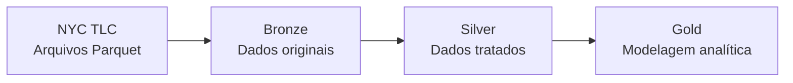
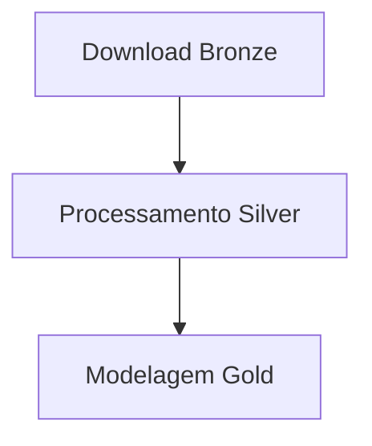

# Urban Mobility Analytics — NYC TLC Yellow Taxi Data Pipeline

Pipeline de Engenharia de Dados end-to-end desenvolvido para processar e analisar dados públicos de corridas de táxi da **New York City Taxi and Limousine Commission (NYC TLC)**.

O projeto implementa a Arquitetura Medalhão (Bronze, Silver e Gold), utilizando Python, PySpark, PostgreSQL, dbt e Apache Airflow.

## 1. Visão geral da arquitetura

O pipeline organiza os dados em três camadas:



### Bronze — Ingestão

- Download incremental dos arquivos Parquet disponibilizados pela NYC TLC.
- Organização dos arquivos por ano e mês.
- Controle de integridade por meio de hash SHA-256.
- Controle de ingestão por manifesto local (`data/metadata/ingestion_manifest.json`) e tabela PostgreSQL (`bronze.ingestion_manifest`).

### Silver — Processamento e qualidade

- Processamento dos arquivos Bronze utilizando PySpark.
- Conversão e padronização de tipos.
- Aplicação de regras de qualidade estrutural.
- Identificação de anomalias operacionais.
- Enriquecimento com a tabela de referência de formas de pagamento.
- Cálculo da receita considerada válida.
- Armazenamento em Parquet particionado e carga no PostgreSQL.

### Gold — Modelagem analítica

- Transformações SQL utilizando dbt, com alternativa de execução SQL nativa.
- Construção de um modelo dimensional Star Schema.
- Criação de dimensões e tabela fato.
- Criação e atualização da Materialized View `gold.mv_monthly_taxi_metrics`.

## 2. Tecnologias utilizadas

| Tecnologia | Aplicação no projeto |
|---|---|
| Python | Ingestão, scripts, CLI e testes |
| PySpark | Processamento e transformação dos dados |
| PostgreSQL | Armazenamento das camadas e serving analítico |
| dbt | Transformações SQL, modelagem e testes |
| Apache Airflow | Orquestração e agendamento |
| Docker Compose | Ambiente integrado de execução |
| Pytest | Testes automatizados |

**Observação:** o PySpark permite processamento distribuído e otimizações para grandes volumes de dados. O consumo de memória depende da configuração do ambiente e dos recursos disponíveis.

## 3. Referência de formas de pagamento

A tabela `silver.ref_payment_type` contém a classificação utilizada no processamento e é refletida na dimensão `gold.dim_payment_type`.

| Código | Descrição | Pagamento válido |
|---:|---|---|
| 1 | Credit card | Sim |
| 2 | Cash | Sim |
| 3 | No charge | Não |
| 4 | Dispute | Não |
| 5 | Unknown | Não |
| 6 | Voided trip | Não |

## 4. Regras de qualidade e anomalias

### Regras de qualidade estrutural

O processamento da camada Silver avalia as seguintes condições:

1. `pickup_datetime_nula`: data e hora de embarque ausentes.
2. `dropoff_datetime_nula`: data e hora de desembarque ausentes.
3. `desembarque_antes_ou_igual_embarque`: desembarque anterior ou igual ao embarque.
4. `duracao_nao_positiva`: duração menor ou igual a zero.
5. `distancia_nula_ou_negativa`: distância nula ou negativa.
6. `valor_total_nulo_ou_negativo`: valor total nulo ou negativo.

A coluna `is_valid_trip` indica se a corrida passou pelas regras estruturais. Quando existem violações, a coluna `invalid_reason` registra os motivos identificados.

### Detecção de anomalias

As seguintes condições são sinalizadas:

- Duração superior a 6 horas (`trip_duration_minutes > 360`).
- Distância superior a 100 milhas (`trip_distance > 100`).

Essas condições são registradas como anomalias e não invalidam automaticamente uma corrida que passou pelas regras estruturais.

### Cálculo da receita válida

A receita é considerada válida quando:

- A corrida é estruturalmente válida (`is_valid_trip = true`).
- A forma de pagamento é válida (`is_valid_payment = true`).

Nos demais casos, `valid_revenue_amount` recebe zero.

## 5. Modelagem analítica — Gold

O modelo dimensional é composto por:

| Modelo | Descrição |
|---|---|
| `gold.dim_vendor` | Dimensão dos fornecedores de tecnologia de pagamento |
| `gold.dim_payment_type` | Dimensão das formas de pagamento |
| `gold.dim_date` | Dimensão calendário |
| `gold.fct_taxi_trips` | Tabela fato das corridas |

### Materialized View

A view `gold.mv_monthly_taxi_metrics` apresenta indicadores agrupados por competência (`pickup_year_month`) e fornecedor (`vendor_id`):

- `total_trips`: total de corridas.
- `total_valid_revenue`: receita total válida.
- `avg_ticket_per_trip`: ticket médio por corrida válida.
- `avg_trip_distance`: distância média das corridas estruturalmente válidas.
- `last_refreshed_at`: data e hora da última atualização.

## 6. Orquestração com Apache Airflow

A DAG `urban_mobility_nyc_taxi_pipeline`, localizada em `dags/nyc_taxi_medallion_dag.py`, organiza o fluxo em três etapas:



As tarefas são:

1. `task_download_bronze`: realiza o download incremental dos arquivos da NYC TLC.
2. `task_process_silver`: executa o processamento PySpark, aplica as regras de qualidade e carrega os dados tratados.
3. `task_process_gold`: executa as transformações dbt ou SQL nativo e atualiza a Materialized View.

A DAG está configurada com agendamento semanal (`@weekly`) e também pode ser disparada manualmente pela interface do Airflow.

## 7. Estrutura do projeto

```text
urban-mobility-pipeline/
├── dags/
│   └── nyc_taxi_medallion_dag.py
├── dbt/
│   ├── dbt_project.yml
│   ├── profiles.yml
│   └── models/
│       ├── staging/
│       └── gold/
├── docker/
│   └── postgres/
│       └── initdb/
├── sql/
│   ├── 01_create_schemas.sql
│   ├── 02_reference_payment_types.sql
│   ├── 03_create_silver_tables.sql
│   ├── 04_create_gold_models.sql
│   └── 05_refresh_materialized_view.sql
├── src/
│   ├── ingestion/
│   ├── processing/
│   ├── database/
│   ├── transform/
│   └── main.py
├── tests/
├── data/
├── docker-compose.yml
├── Dockerfile
├── requirements.txt
├── requirements-airflow.txt
├── .env.example
└── README.md
```

Os diretórios de dados são criados durante a execução. Os arquivos de dados e configurações locais não devem ser versionados no Git.

## 8. Como executar localmente

### Pré-requisitos

- Python 3.10, 3.11 ou 3.12.
- Java 17 ou 21, necessário para o PySpark.
- PostgreSQL instalado e em execução.
- Git.

### 8.1. Clonar o repositório

```bash
git clone https://github.com/mateusdevmelo/urban-mobility-pipeline.git
cd urban-mobility-pipeline
```

### 8.2. Configurar as variáveis de ambiente

Crie seu arquivo `.env` a partir do exemplo:

**Linux/macOS:**

```bash
cp .env.example .env
```

**Windows PowerShell:**

```powershell
Copy-Item .env.example .env
```

Edite o `.env` e configure as credenciais e parâmetros de conexão do PostgreSQL de acordo com seu ambiente.

Para execução local com PostgreSQL instalado diretamente na máquina, utilize a porta configurada no seu servidor. O arquivo de exemplo utiliza a porta `5433`.

### 8.3. Criar e ativar o ambiente virtual

```bash
python -m venv .venv
```

**Windows PowerShell:**

```powershell
.\.venv\Scripts\Activate.ps1
```

**Linux/macOS:**

```bash
source .venv/bin/activate
```

### 8.4. Instalar as dependências

```bash
pip install -r requirements.txt
```

### 8.5. Inicializar o banco de dados

Com o PostgreSQL em execução e o `.env` configurado:

```bash
python src/main.py --step init-db
```

### 8.6. Executar o pipeline completo

Exemplo para processar janeiro a junho de 2025:

```bash
python src/main.py --year 2025 --start-month 1 --end-month 6 --step all
```

Também é possível executar cada camada separadamente:

**Bronze:**

```bash
python src/main.py --year 2025 --start-month 1 --end-month 6 --step bronze
```

**Silver:**

```bash
python src/main.py --year 2025 --start-month 1 --end-month 6 --step silver
```

**Gold:**

```bash
python src/main.py --step gold
```

## 9. Testes de qualidade

Para executar os testes automatizados:

```bash
pytest tests/ -v
```

Para executar os testes do dbt:

```bash
dbt test --project-dir dbt --profiles-dir dbt
```

Os testes verificam componentes como ingestão, regras de qualidade, scripts SQL e estrutura dos modelos dbt.

## 10. Executar com Docker Compose

O projeto também disponibiliza um ambiente integrado com PostgreSQL e Apache Airflow.

### Pré-requisitos

- Docker Desktop ou Docker Engine instalado e em execução.
- Docker Compose V2.

### 10.1. Configurar o arquivo `.env`

Crie o `.env` a partir do `.env.example`:

**Windows PowerShell:**

```powershell
Copy-Item .env.example .env
```

Configure as variáveis obrigatórias para o Docker Compose:

- `DOCKER_POSTGRES_PASSWORD`
- `AIRFLOW_ADMIN_PASSWORD`
- `AIRFLOW_FERNET_KEY`
- `AIRFLOW_WEBSERVER_SECRET_KEY`

Também configure o usuário e o e-mail do Airflow, se desejar.

Não utilize as credenciais de exemplo em ambientes compartilhados. Gere valores próprios e mantenha o arquivo `.env` fora do Git.

### 10.2. Subir os serviços

Na raiz do projeto:

```bash
docker compose up -d --build
```

Verifique o estado dos serviços:

```bash
docker compose ps
```

### 10.3. Acessar o Airflow

A interface web estará disponível em:

`http://localhost:8080`

Utilize o usuário definido em `AIRFLOW_ADMIN_USER` (por padrão, `admin`) e a senha configurada em `AIRFLOW_ADMIN_PASSWORD`.

A DAG `urban_mobility_nyc_taxi_pipeline` estará disponível na interface do Airflow.

### 10.4. Portas do ambiente Docker

O PostgreSQL do Docker é disponibilizado na máquina host pela porta `5434`, encaminhada para a porta `5432` do container.

Dentro da rede Docker, os serviços se comunicam com o PostgreSQL pelo hostname `postgres` e pela porta `5432`.

Isso é diferente da configuração de execução local, cujo exemplo utiliza `localhost:5433`. Ajuste a configuração de conexão conforme o modo de execução escolhido.

## 11. Contribuição

Contribuições são bem-vindas.

Para propor alterações:

1. Faça um fork do repositório.
2. Clone seu fork para sua máquina.
3. Crie uma branch para sua alteração:

```bash
git checkout -b feature/minha-alteracao
```

4. Faça as alterações e execute os testes.
5. Registre suas alterações em um commit:

```bash
git add .
git commit -m "feat: describe your change"
```

6. Envie a branch para seu fork:

```bash
git push origin feature/minha-alteracao
```

7. Abra um Pull Request para o repositório original.

---

**Projeto:** Urban Mobility Analytics — NYC TLC Yellow Taxi Data Pipeline  
**Repositório:** https://github.com/mateusdevmelo/urban-mobility-pipeline